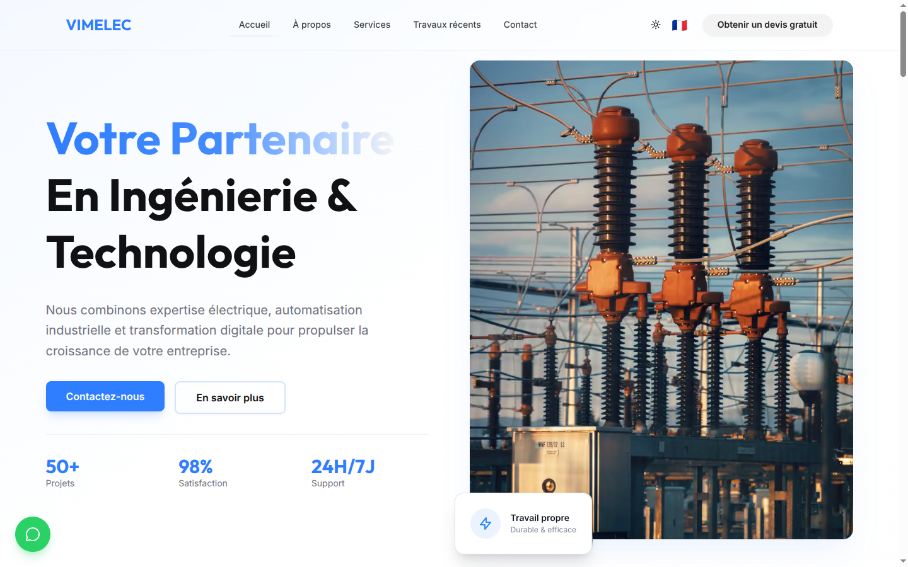
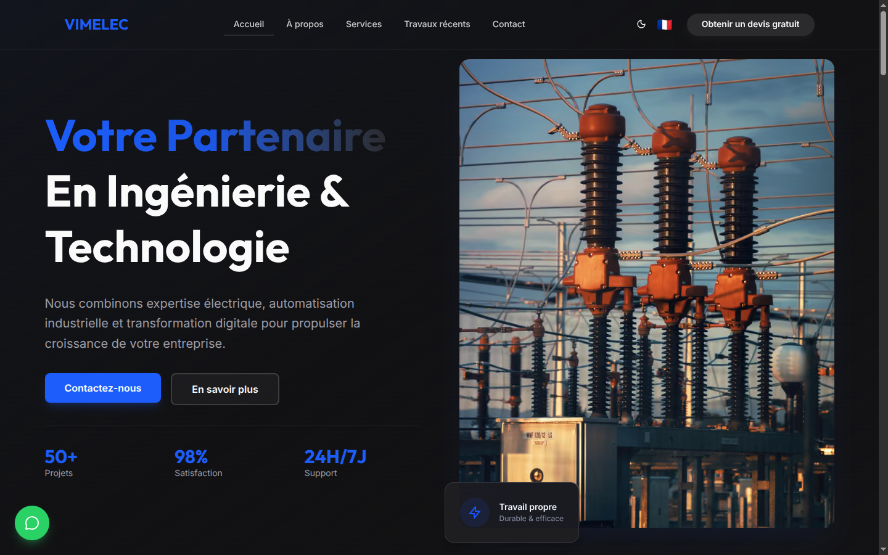
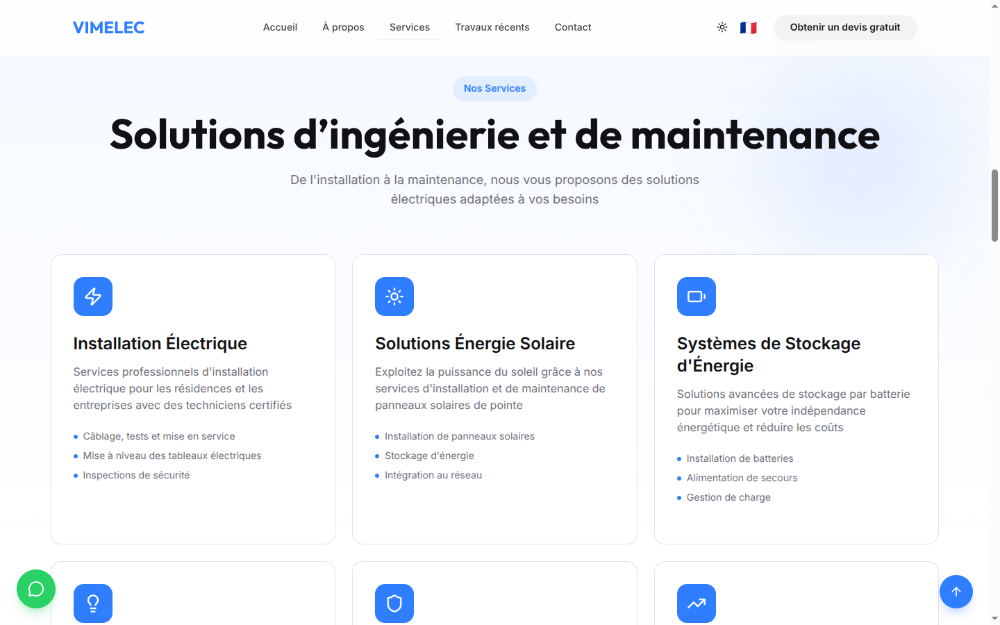
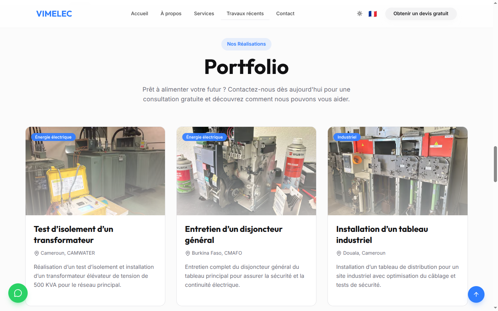
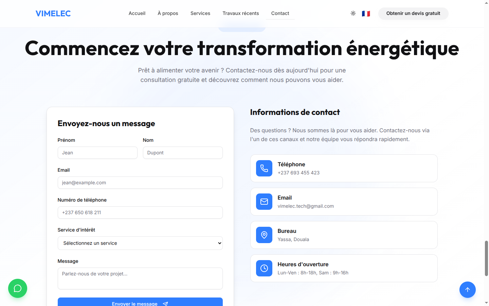

# VIMELEC — Site vitrine d'une entreprise d'ingénierie électrique

> Site officiel de **VIMELEC** (Vente, Ingénierie et Maintenance Électriques), entreprise basée à Douala. Il est bilingue (français / anglais), dispose d'un thème clair et sombre, d'animations au défilement et d'un formulaire de contact qui envoie directement les demandes de devis par email.

**🌐 Site en ligne : [vimelec.tech](https://vimelec.tech/fr)**




---

## Aperçu

| Thème sombre | Services |
|---|---|
|  |  |
| **Réalisations** | **Contact et demande de devis** |
|  |  |

## Fonctionnalités

- **Bilingue français / anglais** avec `next-intl` : routes par langue (`/fr`, `/en`), sélecteur de langue et traductions dans `messages/`.
- **Thème clair et sombre** avec `next-themes`.
- **Formulaire de contact** qui envoie les demandes par email via **EmailJS**, sans serveur à maintenir.
- **Bouton WhatsApp** flottant pour joindre l'entreprise directement.
- **Animations** au défilement avec `motion`, et compteurs animés (projets, satisfaction, support).
- **Référencement** : sitemap généré, image Open Graph par langue pour les partages sur les réseaux sociaux.
- **Mesure d'audience** avec Vercel Analytics.
- Page 404 personnalisée et bouton de retour en haut de page.

## Sections du site

| Section | Composant |
|---|---|
| Accueil (hero, chiffres clés) | [`hero-section.tsx`](components/hero-section.tsx) |
| À propos | [`about-us.tsx`](components/about-us.tsx) |
| Services (7 domaines) | [`services.tsx`](components/services.tsx) |
| Réalisations (portfolio de chantiers) | [`recents-work.tsx`](components/recents-work.tsx) |
| FAQ | [`faq.tsx`](components/faq.tsx) |
| Contact | [`contact-us.tsx`](components/contact-us.tsx) |

## Stack technique

| Domaine | Technologies |
|---|---|
| Framework | Next.js 15 (App Router, Turbopack), React 19, TypeScript |
| Style | Tailwind CSS 4, composants shadcn/ui (Radix UI), lucide-react |
| Internationalisation | next-intl |
| Animations | motion |
| Formulaire | EmailJS |
| Déploiement | Vercel (déploiement continu depuis `main`), Vercel Analytics |

## Structure du projet

```
VIMELEC/
├── app/
│   ├── [locale]/            # Pages par langue (fr, en), 404, image Open Graph
│   ├── sitemap.ts           # Sitemap généré
│   └── globals.css
├── components/              # Sections du site et composants d'interface
│   └── ui/                  # Composants shadcn/ui
├── messages/                # Traductions : fr.json, en.json
├── i18n/, middleware.ts     # Configuration et routage multilingue
├── services/sendEmail.ts    # Envoi du formulaire via EmailJS
├── hooks/use-count-up.ts    # Compteurs animés
├── data/contacts.ts         # Coordonnées de l'entreprise
└── public/                  # Images et fichiers statiques
```

## Lancer le projet en local

```bash
git clone https://github.com/jeanronald22/VIMELEC.git
cd VIMELEC
npm install
```

Créer un fichier `.env.local` avec les identifiants EmailJS, nécessaires au formulaire de contact :

```bash
NEXT_PUBLIC_EMAILJS_SERVICE_ID=...
NEXT_PUBLIC_EMAILJS_TEMPLATE_ID=...
NEXT_PUBLIC_EMAILJS_USER_ID=...
```

Puis lancer le serveur de développement :

```bash
npm run dev
```

Le site est alors disponible sur [http://localhost:3000](http://localhost:3000).

| Commande | Rôle |
|---|---|
| `npm run dev` | Serveur de développement (Turbopack) |
| `npm run build` | Build de production |
| `npm run start` | Lancement du build de production |
| `npm run lint` | Vérification ESLint |

## Déploiement

Le site est déployé sur **Vercel**, avec un déploiement automatique à chaque push sur la branche `main`. Il est servi sur le domaine [vimelec.tech](https://vimelec.tech/fr).

## À propos de VIMELEC

**VIMELEC** propose des solutions électriques complètes :

- installation électrique, énergie solaire et stockage d'énergie ;
- domotique, maintenance et conseil énergétique ;
- développement logiciel et transformation digitale.
